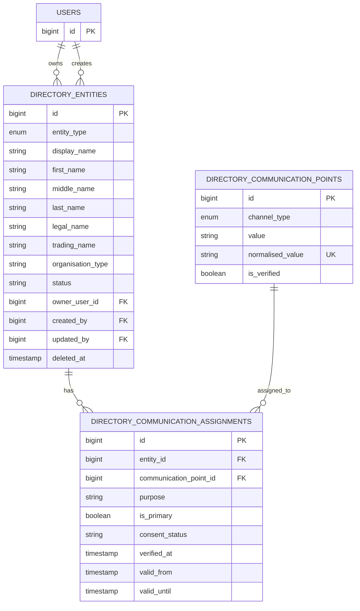

# Contacts & Company 360° — Initial Logical ERD

This logical model supports the first usable directory slice. Its migration is additive and does not alter existing leads, clients, projects, or properties tables.

## Entity relationship diagram

## Cardinality and integrity

| Relationship | Cardinality | Constraint |
|---|---|---|
| User → owned directory entity | 1:N | owner_user_id foreign key |
| Directory entity → communication assignment | 1:N | Assignment cascades when entity is hard-deleted |
| Communication point → assignment | 1:N | Unique channel + normalised value |
| Entity ↔ communication point | N:M | Unique entity + point + purpose assignment |

## Field dictionary

### directory_entities

| Field | Type | Rules / meaning |
|---|---|---|
| id | bigint | Primary key |
| entity_type | enum | person or company |
| display_name | varchar(190) | Required profile/search label |
| first_name, middle_name, last_name | varchar(100) | Person name components |
| legal_name, trading_name | varchar(190) | Organisation names |
| organisation_type | varchar(100) | LLP, private limited, partnership, etc. |
| pan | varchar(10) | Reserved sensitive identifier; hidden from model serialization |
| gstin | varchar(15) | Reserved registration identifier; hidden from model serialization |
| cin | varchar(21) | Reserved registration identifier; hidden from model serialization |
| website | varchar(190) | Organisation website |
| status | varchar | Lifecycle status; defaults to active |
| notes | text | User-entered profile notes |
| owner_user_id | bigint | Required record owner |
| created_by, updated_by | bigint nullable | Actor attribution |
| created_at, updated_at, deleted_at | timestamps | Lifecycle and soft delete |

### directory_communication_points

| Field | Type | Rules / meaning |
|---|---|---|
| id | bigint | Primary key |
| channel_type | enum | mobile, phone, email |
| value | varchar(254) | Original display value |
| normalised_value | varchar(254) | Deduplication/search value |
| is_verified | boolean | Channel-level verification state |
| created_at, updated_at | timestamps | Audit timestamps |

Unique key: (channel_type, normalised_value).

### directory_communication_assignments

| Field | Type | Rules / meaning |
|---|---|---|
| id | bigint | Primary key |
| entity_id | bigint | Directory entity foreign key |
| communication_point_id | bigint | Shared communication point foreign key |
| purpose | varchar | General, work, billing, etc. |
| is_primary | boolean | Primary within this entity + purpose context |
| consent_status | varchar | Unknown by default; not implied by verification |
| verified_at | timestamp nullable | Assignment-level verification |
| valid_from, valid_until | timestamp nullable | Historical validity |
| created_at, updated_at | timestamps | Assignment audit timestamps |

Unique key: (entity_id, communication_point_id, purpose).

## Implementation boundaries

- Initial interface creates and reads person/company records and assigns one mobile/email on create.
- Records are scoped to the authenticated owner. Shared communication-point rows are reused, but another user's entity, notes, and assignments are not returned by the directory controller.
- Branch hierarchy, director/ownership roles, property/project links, KYC document storage, name dictionary management, duplicate review, edit/archive screens, and tenant-to-tenant sharing are not yet implemented.
- Add typed relationship records and addresses only after reviewing existing project/property/contact structures and ownership rules.
- Back up production data and run this migration in preview/staging before production.